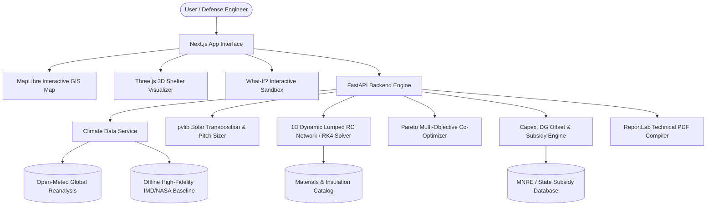

# GEOTHERM SHIELD: Architecture Specification

## System Data Flow

## Scientific Methodology & Formulas

### 1. Thermal Envelope Conductance
$$UA_{total} = \sum_{i} U_i A_i + \dot{V} \cdot \rho_{air}(z) \cdot C_p$$
where air density varies with altitude:
$$\rho_{air}(z) = 1.225 \cdot \exp\left(-\frac{z}{8500}\right) \text{ kg/m}^3$$

### 2. Runge-Kutta 4th Order (RK4) Numerical Solvers
The differential temperature change is integrated numerically:
$$\Delta T = \frac{\Delta t}{6} (k_1 + 2k_2 + 2k_3 + k_4)$$
preventing numerical instability under rapid exterior diurnal shifts.

### 3. Solar Shading & Inter-Row Pitch
Row pitch to prevent winter solstice shading at noon:
$$\text{Spacing Multiplier} = 1.0 + \frac{\sin(\beta_{tilt})}{\tan(\alpha_{winter\_sun})} \cdot 0.4$$
